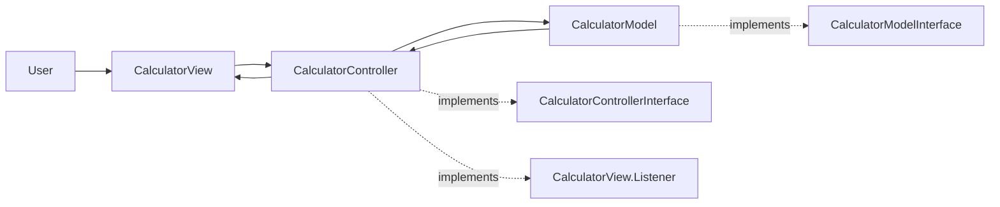
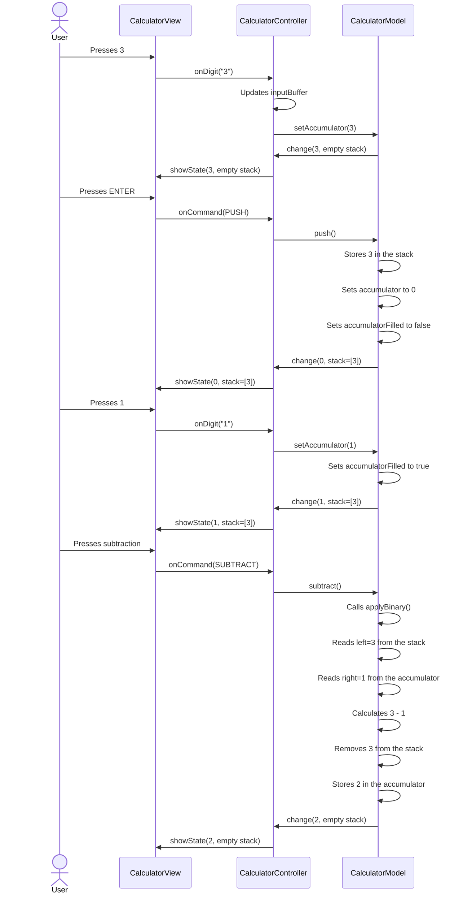
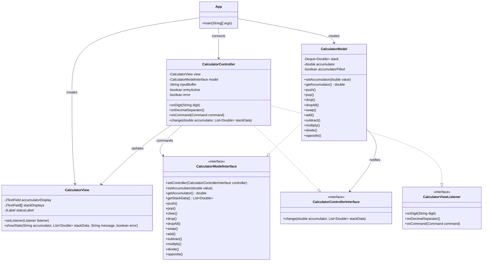
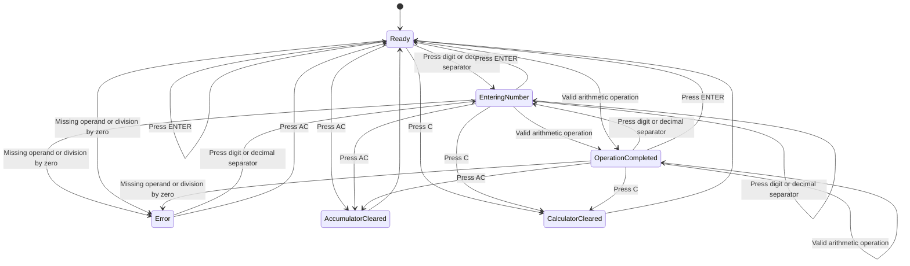
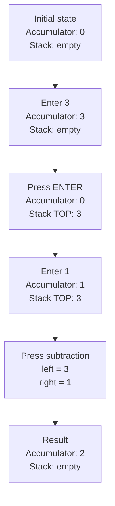
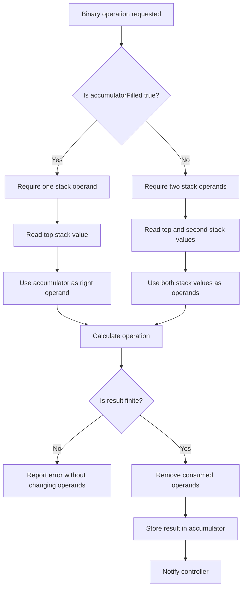

# RPN Calculator Diagrams

These Mermaid diagrams document the architecture and behavior of the RPN calculator.

They can be previewed in Visual Studio Code with a Mermaid-compatible Markdown extension or exported as SVG, PNG, or PDF using the [Mermaid Live Editor](https://mermaid.live/).

## 1. MVC Architecture

## 2. Sequence Diagram: `3 ENTER 1 -`

## 3. Class Diagram

## 4. Calculator State Diagram

## 5. Stack and Accumulator Flow

## 6. Binary Operation Logic

